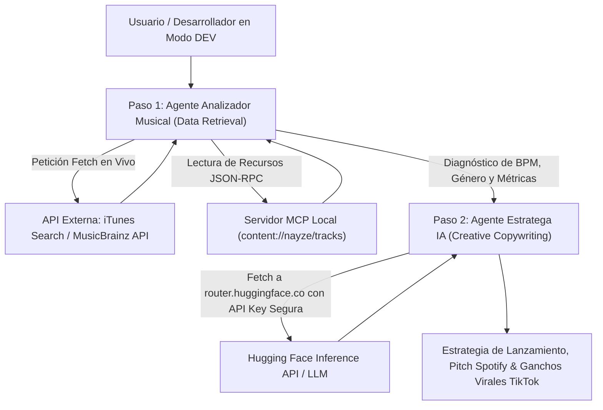

# 🎮 NAYZE Studio - Experiencia Interactiva 8-Bit & Plataforma Agéntica Musical (MVP)

> **Producto Mínimo Viable (MVP)** para la industria musical que fusiona una experiencia web inmersiva de lanzamiento discográfico con **arquitectura agéntica**, consumo de **APIs de IA y datos en tiempo real**, y desarrollo asistido mediante **Model Context Protocol (MCP)** y **Skills modulares**.

---

## 🌐 1. Enlace de la Aplicación en Vivo (GitHub Pages)

* **URL Pública de Despliegue:** `https://[usuario].github.io/[repositorio]/`
* **Acceso al Modo Desarrollador (Agente MCP):** Presiona `Ctrl + Shift + D` (o `Cmd + Shift + D` en macOS) o haz clic en el botón `[DEV]` en la esquina inferior.

---

## 🚀 2. Arquitectura del Proyecto & Flujo Agéntico (Encadenamiento en 2 Pasos)

La plataforma opera bajo un flujo de agentes encadenados donde la salida del primer agente alimenta al segundo de manera secuencial:



### Detalle de los Pasos:
1. **Paso 1 // Agente Analizador Musical:**
   - Realiza una consulta `fetch` a una fuente de datos musical externa en vivo (**iTunes Search API** / **MusicBrainz API**) para obtener metadatos de mercado (género, fecha, preview de audio).
   - Cruza estos datos con el Servidor MCP local (`content://nayze/tracks` y `content://marketing/campaign-status`) para evaluar BPM, tonalidad de stems y porcentaje de pre-saves alcanzado.
   - Produce un diagnóstico cuantitativo del sencillo.
2. **Paso 2 // Agente Estratega IA:**
   - Toma como entrada directa el diagnóstico generado en el Paso 1.
   - Consume en vivo un modelo de IA mediante `fetch` a la API de **Hugging Face** (`https://router.huggingface.co/hf-inference/models/meta-llama/Llama-3.2-3B-Instruct` o `mistralai/Mistral-7B-Instruct-v0.3`).
   - Genera el Pitch editorial para *Spotify for Artists*, 3 ganchos virales para TikTok/Reels y un plan de acción para maximizar conversiones hacia el lanzamiento oficial.

---

## 🤖 3. Implementación de Model Context Protocol (MCP) & Skills

### Servidor MCP Local (`mcp-server.js`)
El proyecto implementa la especificación **Model Context Protocol (JSON-RPC 2.0)** para conectar datos estructurados con agentes de IA:

* **Recursos expuestos (`resources`):**
  - `content://nayze/tracks`: Ficha técnica del sencillo *Vuelve Bebé*, BPM (128), tonalidad (Fa menor) y estado de desbloqueo de los 4 stems de audio.
  - `content://marketing/campaign-status`: Métricas en vivo de la campaña de Pre-Save (meta, porcentaje alcanzado, desglose Spotify/Apple Music/TikTok).
  - `content://nayze/live-game-progress`: Sincronización del progreso del minijuego 8-bit en tiempo real.
* **Herramientas expuestas (`tools`):**
  - `query_tracks`: Filtra stems y datos técnicos por ID.
  - `get_campaign_kpis`: Proyecta estimaciones de reproducciones basadas en la tasa de pre-saves.
  - `reset_game_progress`: Reinicia el estado de progreso para pruebas de QA.

### Skill Personalizado (`/skills/SKILL.md`)
El archivo [`skills/SKILL.md`](skills/SKILL.md) contiene las directivas específicas de dominio musical utilizadas por el agente:
* Reglas de redacción de pitches editoriales optimizadas para los primeros 30 segundos evaluados por curadores.
* Matriz de ganchos virales para TikTok (Misterio, Gamificación y Producción de Sintetizadores).
* Protocolos de encadenamiento y seguridad en el manejo de tokens.

---

## 📸 4. Evidencia de Uso de MCP durante el Desarrollo

Durante la construcción del proyecto se utilizaron servidores MCP (Filesystem MCP, Local MCP Server y GitHub MCP) para inspección de recursos, lectura de stems y control de versiones:

```text
+-------------------------------------------------------------------------------+
|  NAYZE DEV ADMIN // MCP & SKILLS CONSOLE (Ctrl + Shift + D)                  |
|  Status: Servidor MCP Activo (Protocol 2024-11-05 • Client Mode: internal)   |
+-------------------------------------------------------------------------------+
|  [⚡ Skills Playground]      [📊 Recursos content://]      [⚙️ JSON-RPC Tester]  |
+-------------------------------------------------------------------------------+
|  > Conectando con servidor local MCP... OK                                    |
|  > Recurso cargado: content://nayze/tracks (BPM: 128 | Fa Menor | 4 Stems)    |
|  > Recurso cargado: content://marketing/campaign-status (18,420 Pre-Saves)   |
+-------------------------------------------------------------------------------+
```

> **Captura de Pantalla:**  
> Puedes consultar la captura visual de la consola MCP y del inspector de recursos en `docs/mcp-server-evidence.png` (o agregar tu captura en esta sección al desplegar).

---

## 🔒 5. Seguridad de API Keys (Zero-Storage Policy)

Siguiendo las mejores prácticas de seguridad requeridas:
* **Prohibición de Tokens en Repositorio:** El repositorio no contiene ninguna API Key privada hardcodeada.
* **Campo de Entrada Tipo Contraseña (`<input type="password">`):** En la consola del desarrollador (Pestaña *Skills*), el usuario ingresa su propio Token de **Hugging Face** (`hf_...`) o clave de LLM en un campo seguro que oculta los caracteres.
* **Manejo de Estados de Carga:** La interfaz muestra un indicador animado (`loading-spinner`) durante las peticiones y mensajes claros si las credenciales son incorrectas o no han sido ingresadas.

---

## 🛠️ 6. Pila Tecnológica & APIs Integradas

| Componente | Tecnología / API | Propósito |
|---|---|---|
| **Frontend** | HTML5, CSS3 Retro-Moderno, JavaScript Vanilla | Despliegue estático sin dependencias para GitHub Pages |
| **Consumo LLM** | Hugging Face Inference API (`router.huggingface.co`) | Generación en vivo de copys y pitches estratégicos |
| **API Externa de Música** | iTunes Search API / MusicBrainz API | Consulta en vivo de metadatos de canciones y tendencias |
| **Motor de Audio Retro** | Web Audio API (Osciladores Square, Triangle) | Sintetizador de efectos retro de 8-bits (hits, saltos, daño) |
| **Arquitectura de Datos** | Model Context Protocol (MCP JSON-RPC 2.0) | Desacoplamiento de datos internos y herramientas para IA |
| **Seguridad 2FA** | REST API EmailJS (`api.emailjs.com`) | Autenticación OTP por correo para el Modo Desarrollador |

---

## 📦 7. Instrucciones para Desplegar en GitHub Pages

1. **Subir el repositorio a GitHub:**
   ```bash
   git init
   git add .
   git commit -m "feat: MVP NAYZE con arquitectura agéntica, MCP y Skills"
   git branch -M main
   git remote add origin https://github.com/[tu-usuario]/[tu-repositorio].git
   git push -u origin main
   ```
2. **Activar GitHub Pages:**
   - Entra a los **Settings** de tu repositorio en GitHub.
   - En el menú lateral izquierdo, haz clic en **Pages**.
   - Bajo **Build and deployment > Source**, selecciona **Deploy from a branch**.
   - En **Branch**, selecciona `main` y `/ (root)`, luego pulsa **Save**.
3. **Probar la App en vivo:**
   - Tu app estará disponible en: `https://[tu-usuario].github.io/[tu-repositorio]/`
